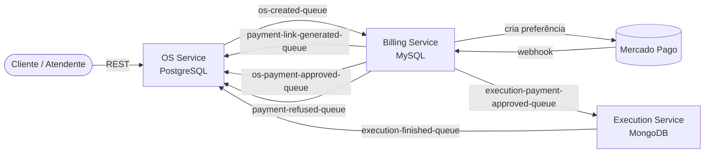

# 🔧 Oficina Mecânica — Microsserviços

Sistema de gestão para oficinas mecânicas, desenvolvido na Pós-Graduação em **Arquitetura de Software (FIAP)** por [Lucas Scuissiatto](https://github.com/luscuissiatto).

O projeto começou como um monolito e foi evoluído para **três microsserviços** que se comunicam por eventos no RabbitMQ, coordenados pelo padrão **saga (coreografia)**, com pagamento real via **Mercado Pago**.

## Arquitetura

## Fluxo da saga

1. O **OS Service** registra cliente, veículo e itens da ordem de serviço. Ao fechar o orçamento, publica a OS em `os-created-queue`.
2. O **Billing Service** gera o link de pagamento no Mercado Pago e o devolve ao OS Service, que envia o link ao cliente por e-mail.
3. O Mercado Pago confirma o pagamento via webhook:
   - **aprovado** → a OS vai para `IN_PROGRESS` e o **Execution Service** cria a ordem de execução;
   - **recusado** → evento de compensação, e a OS vai para `REFUSED`.
4. O mecânico conclui o reparo no Execution Service, que publica `execution-finished-queue`, e a OS é finalizada como `COMPLETED`.

## Resiliência

- **Retry** com espera crescente em todos os consumidores.
- **DLQ por serviço**: mensagens que falham em todas as tentativas são guardadas com o motivo da falha, para investigação e reprocessamento.
- **Consumidores idempotentes**: reentregas não duplicam cobranças, ordens de execução nem e-mails.

## Repositórios

| Repositório | Responsabilidade | Stack |
| --- | --- | --- |
| [oficina-os-service](https://github.com/oficina-mecanica-app/oficina-os-service) | Clientes, veículos e ciclo de vida da OS (orquestra o fluxo) | Java 17, Spring Boot, PostgreSQL, Cucumber |
| [oficina-billing-service](https://github.com/oficina-mecanica-app/oficina-billing-service) | Cobrança e integração com o Mercado Pago | Java 17, Spring Boot, MySQL |
| [oficina-execution-service](https://github.com/oficina-mecanica-app/oficina-execution-service) | Execução do reparo na oficina | Java 17, Spring Boot, MongoDB |
| [oficina-infra-k8s](https://github.com/oficina-mecanica-app/oficina-infra-k8s) | Infra local (docker-compose) e manifestos Kubernetes | RabbitMQ, bancos, MailHog, SonarQube |

## Qualidade

Cada serviço tem testes unitários (JUnit 5 e Mockito), cobertura com JaCoCo e pipeline no GitHub Actions que roda os testes, envia a análise para o SonarCloud e publica a imagem Docker. O OS Service também tem testes de aceitação em BDD com Cucumber.
